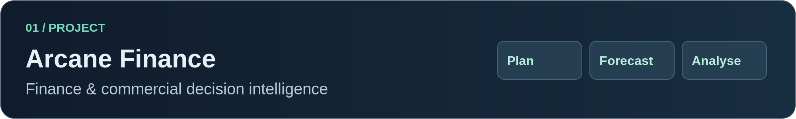

[Portfolio](https://denisdo.com) · Singapore / APAC

## Finance leader. Technology builder.

I combine regional finance leadership with hands-on analytics, automation and AI-assisted software development. My focus is turning complex commercial and operational challenges into practical, scalable solutions.

Previously APAC Finance Director at adm × Indicia and regional Sales Finance Senior Manager at Twitter/X, partnering with a US$1B+ JAPAC business.

## Selected projects

**Arcane Finance** · In development

A finance and revenue operations platform designed around the needs of commercial and finance leaders. Its intended scope includes scenario planning, forecasting, performance analytics and AI-assisted decision support.

**Intelligent Photo Curation** · In development

A computer vision project exploring scalable image ingestion, semantic analysis, duplicate detection and preference-aware selection to create cohesive photo albums.

Both projects are currently private. Public case studies and demonstrations are planned.

## Expertise

| Finance & strategy | Revenue operations | Technology |
| --- | --- | --- |
| Strategic Finance & FP&A | GTM planning | Python & SQL |
| Commercial Finance | Territory & quota design | Power BI & Tableau |
| Forecasting & modelling | Deal strategy | Data pipelines & automation |
| Business partnering | Sales performance | Applied AI |

## Currently exploring

AI-native finance applications, autonomous agent orchestration, decision intelligence and scalable data processing.

---

[denisdo.com](https://denisdo.com)
